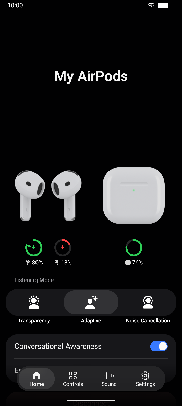
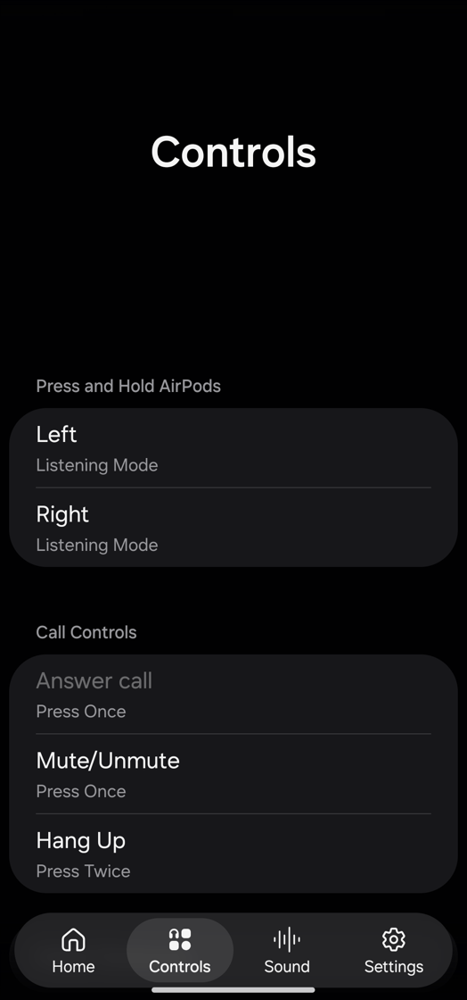
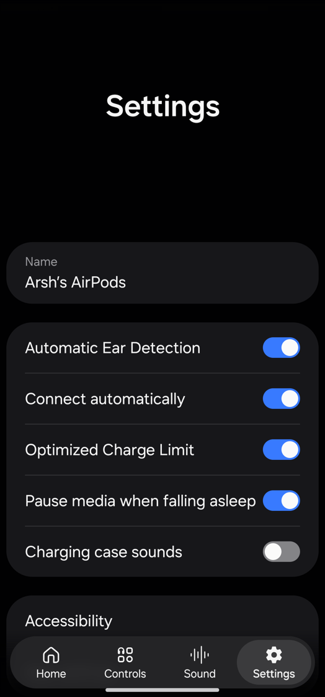
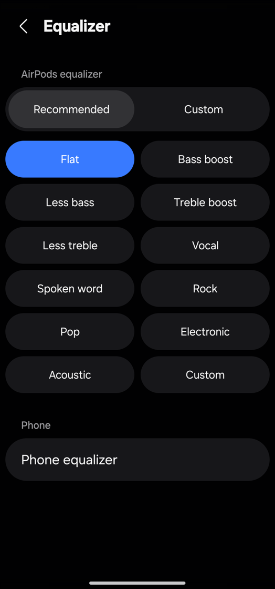
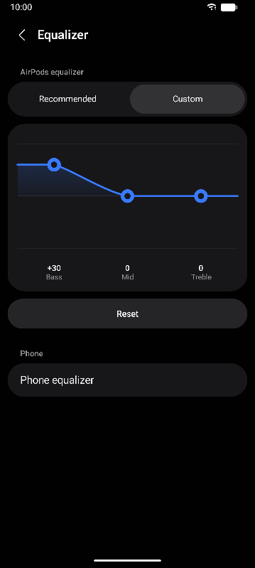
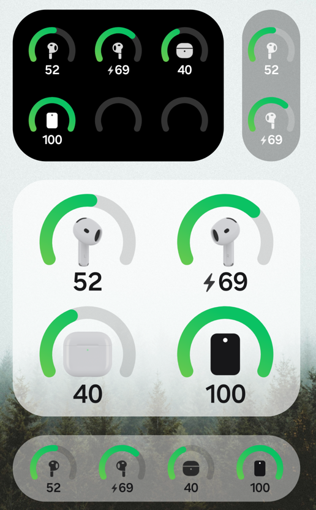

<p align="center">
  <picture>
    <source media="(prefers-color-scheme: dark)" srcset="screenshots/icon-dark.png">
    
  </picture>
</p>

<h1 align="center">Pods</h1>

Pods is an Android companion app for AirPods, with an interface that follows Samsung One UI. On Android 17 or newer it works without root.

Pods is an independent community project, not affiliated with or endorsed by Apple or Samsung. AirPods is a trademark of Apple Inc., and the product pictures shown in the app belong to their owner.

## Screenshots

| Home | Controls | Settings |
|---|---|---|
|  |  |  |

| Equalizer presets | Custom equalizer |
|---|---|
|  |  |

**Battery widgets** in several sizes on the home screen:



Screenshots are from a Galaxy S24 with AirPods 4 (ANC).

## Features

What you see depends on the AirPods model, firmware and Android version. Unsupported controls are hidden.

### Everyday use
- Home, Controls, Sound and Settings pages with a floating tab bar.
- Battery levels for the earbuds and case, and a Quick Settings tile for listening modes.
- Listening modes: noise cancellation, transparency, adaptive audio and off, where available.
- Press-and-hold actions, call controls, microphone choice, ear detection and automatic connection.
- Rename the AirPods directly on the Settings page.
- Pictures and icons that match the connected model.

### Equalizer
- Flat (the default) and presets for the AirPods' own three-band equalizer, plus a custom graph for bass, mid and treble.
- Your hand-made setting is saved as **Custom** next to the presets, so you can switch back to it. Reset clears it.
- A shortcut to Samsung's or Android's phone equalizer. Pods does not process audio.

### Battery widget
- Matches the Galaxy battery widget and adapts to its shape: two cells show the earbuds, three add the case, and four or a square add the phone.
- Sizes with spare room, such as 3×2, 2×3 and 4×2, fill it with empty rings. Anything larger shows the AirPods pictures in large rings.
- Rings turn red at 20% or below, in the widget and in the app.
- Touch and hold the widget and tap **Settings** to choose a system, dark or light background and its transparency.

### Low battery
- One notification lists whatever is at 10% or below, and pops up at 10%, 5%, 2% and 1%.
- Where live notifications are available it stays up and follows the levels in between. Otherwise it appears only at those four levels.
- On Android 16 and later it can appear as a live update. On Galaxy phones, showing it in the Now bar may require **Developer options → Live notifications for all apps**.

### Other settings
- Charging case sounds on or off. The AirPods do not report this setting, so Pods sends your choice each time they connect.
- Conversational awareness, personalized and adaptive volume, optimized charging and sleep detection.
- Accessibility and hearing features on compatible AirPods and firmware, and head gestures.
- The optional "Act as an Apple device" setting appears only when a compatible Xposed environment is detected.

## Supported AirPods

AirPods 1, 2, 3, 4, 4 with noise cancellation and 5; AirPods Pro 1, 2 and 3. AirPods Max support is experimental and has not been tried on real hardware.

## Requirements and permissions

Without root, Pods needs one of these:

- **Android 17 or newer**, on any maker's phone. It is tested on a Galaxy S24 with One UI 9.
- Android 16 on OnePlus, OPPO or realme phones.
- A Pixel on an Android 16 `CP1A` build.

Other phones need root with an Xposed framework, because of a limit in Android's Bluetooth system.

You also need Bluetooth and compatible AirPods. The FOSS build installs on Android 13 (API 33) or newer, and the Play build on Android 16 (API 36) or newer.

On first launch the app asks for the permissions it uses, such as nearby devices, notifications and phone state for call controls. Grant only what the features you want need.

Android requires a notification while the background service runs. Pods cannot hide it by itself: tap it, or use **App settings → Hide background notification**, and turn that channel off. The service keeps running.

After installing an update, open Pods once so the service starts again.

## Build

Open the `android` directory in Android Studio, or build from a terminal with JDK 21 and the Android SDK. The project uses Android SDK 37 and NDK 30.0.16248370 with CMake 4.1.2.

From the `android` directory:

```bash
./gradlew :app:testFossDebugUnitTest        # unit tests
./gradlew :app:assembleFossDebug            # FOSS debug APK
./gradlew :app:assembleFossRelease          # FOSS release APK
./gradlew :app:bundlePlayRelease            # Play release bundle
./gradlew :app:packageReleaseArtifacts      # collect APKs and bundle in ../release/
```

Build outputs are written under `app/build/outputs/`.

### Release signing

Release builds read the signing values from `android/local.properties`. That file and `.jks` keystores are ignored by Git. Keep the keystore and its passwords backed up and never commit them.

```properties
RELEASE_STORE_FILE=/absolute/path/to/pods-upload.jks
RELEASE_STORE_PASSWORD=your-store-password
RELEASE_KEY_ALIAS=pods-upload
RELEASE_KEY_PASSWORD=your-key-password
```

For a new Play Store listing, upload the signed `.aab` and enroll in Play App Signing. The local keystore is then the upload key; Play Console shows the app-signing certificate. For an existing listing, keep its package name and signing setup.

## Project layout

- `android/app/src/main/java/` — app and Bluetooth code.
- `android/app/src/main/res/` — resources and launcher icons.
- `android/app/src/main/res-apple/` — AirPods product pictures.
- `android/app/src/test/` — unit tests.
- `android/app/build.gradle.kts` — build variants, version, signing and release tasks.
- `screenshots/` — the icon and screenshots used in this page.

## License

Pods is distributed under the [GNU General Public License v3 or later](LICENSE). It is a modified version of earlier GPL-licensed work, changed in 2026, and source files keep their copyright notices.
